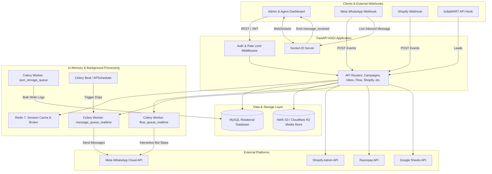

# 📱 Liliya API – Enterprise WhatsApp Marketing & Automation Platform

> **Backend Architecture & System Overview for Portfolio**  
> *A high-throughput, asynchronous conversational marketing engine, visual flow chatbot builder, and multi-agent customer communication platform powered by FastAPI, Celery, Redis, and Meta WhatsApp Cloud API.*

---

## 📌 Executive Summary

**Liliya API** is a production-grade, multi-tenant SaaS backend built to automate business communications via the official **Meta WhatsApp Cloud API**. Designed for marketing campaigns, conversational sales funnels, customer support, and eCommerce workflows, the system processes thousands of messages concurrently with low latency and enterprise-level reliability.

The backend combines **FastAPI (ASGI)** for asynchronous API throughput, **Celery + Redis** for distributed job queues, a **visual chatbot execution engine**, **Socket.IO** for real-time team inbox collaboration, and deep integrations with **Shopify, IndiaMART, Razorpay, Google Sheets, and AWS S3/Cloudflare R2**.

---

## 🚀 Core Features & Business Capabilities

1. **Mass Campaign Dispatch & Broadcast Engine**:
   - Asynchronous batch processing of outbound WhatsApp campaigns.
   - Intelligent concurrency throttling (`asyncio.Semaphore`), dynamic pacing, and retry mechanisms compliant with Meta’s rate limits.
   - Contact segmentation, custom CSV/Excel uploads, and dynamic message templating.

2. **Interactive Visual Flow & Chatbot Automation**:
   - Multi-step, node-based conversational tree runner (interactive buttons, list menus, media messages, text capture).
   - Fast Redis-backed conversational session state tracking with asynchronous bulk-persistence to MySQL.
   - Answer storage, variable interpolation, and dynamic webhook-triggered workflows.

3. **Real-Time Multi-Agent Shared Team Inbox**:
   - Bi-directional live messaging with customers over WebSockets (`python-socketio`).
   - Chat assignment, canned responses, contact tagging/labeling, and audit logs.
   - Live message status updates (*Sent*, *Delivered*, *Read*, *Failed*).

4. **Multi-Channel & eCommerce Integrations**:
   - **Shopify**: OAuth app connection, automated abandoned cart recovery sequences, order confirmation, and fulfillment tracking alerts.
   - **IndiaMART**: Ingestion of B2B business inquiries with instant WhatsApp auto-responders.
   - **Razorpay**: Payment link generation, order creation, transaction verification, and instant receipt dispatch.
   - **Google Sheets**: Two-way synchronization of leads, campaign recipients, and survey responses.

5. **Security, Governance & Multi-Tenancy**:
   - Role-Based Access Control (RBAC) with granular permissions (Admin, Agent, Manager).
   - Message quota enforcement, daily spend limits, and rate-limiting middleware (`SlowAPI`).
   - Media file handling securely backed by AWS S3 / Cloudflare R2 object storage.

---

## 🛠️ Technology Stack & Architecture

### 1. Core Technologies
| Layer | Technology | Rationale / Usage |
| :--- | :--- | :--- |
| **Language** | **Python 3.10+ / 3.11** | High productivity, rich ecosystem for async networking and data manipulation. |
| **Framework** | **FastAPI** (v0.111+) | Ultra-fast ASGI framework with native asynchronous support, Pydantic type validation, and automatic OpenAPI schema generation. |
| **ASGI Server** | **Uvicorn** + **uvloop** | Production ASGI server with ultra-low latency event loop implementation in C. |
| **Primary Database** | **MySQL 8.0+** | Relational data persistence for multi-tenant users, campaigns, messages, audit logs, and CRM records. |
| **ORM & Migrations** | **SQLAlchemy 2.0** + **Alembic** | Connection pooling (pre-ping, recycle, overflow handling), declarative data models, and versioned database migrations. |
| **Cache & In-Memory Store** | **Redis** (v7.0+) | Real-time session state store, flow trigger cache, distributed rate limiting, and deduplication locks. |
| **Message Broker & Task Queue**| **Celery** (v5.5+) | Distributed asynchronous background worker queues for campaign dispatch, storage writing, and automated drip sequences. |
| **Real-Time WebSockets** | **Socket.IO** (`python-socketio`) | Full-duplex WebSocket connection management for real-time inbox messaging and agent status alerts. |
| **Object Storage** | **AWS S3 / Cloudflare R2** (`boto3`) | High-durability object storage for media attachments (images, audio, PDF brochures, video). |

---

### 2. Key Libraries & Modules Used

```
├── Framework & Networking:
│   ├── fastapi, starlette, uvicorn, uvloop
│   ├── python-socketio, python-engineio (Real-time WebSockets)
│   ├── httpx, aiohttp, requests (Async & sync HTTP clients)
│
├── Database & Caching:
│   ├── SQLAlchemy (2.0 ORM with connection pooling)
│   ├── PyMySQL (Pure-Python MySQL client driver)
│   ├── alembic (Database migration framework)
│   ├── redis (Python Redis client)
│
├── Asynchronous & Distributed Tasks:
│   ├── celery (Task queue orchestration)
│   ├── kombu, amqp, billiard (AMQP transport & concurrency primitives)
│   ├── APScheduler (Advanced Python Scheduler for recurring cron jobs)
│
├── Security & Authentication:
│   ├── python-jose (JWT generation & validation)
│   ├── passlib + bcrypt (Secure password hashing)
│   ├── slowapi (API rate limiting middleware)
│   ├── Authlib, requests-oauthlib (OAuth 2.0 flows for Google & Shopify)
│
├── Data Processing & Media:
│   ├── pandas, openpyxl (CSV/Excel spreadsheet parsing & chat data export)
│   ├── weasyprint (High-fidelity HTML to PDF rendering)
│   ├── boto3, botocore (AWS S3 & Cloudflare R2 SDK)
│   ├── python-magic (MIME type auto-detection for uploaded files)
│   ├── phonenumbers (Google's library for international phone number parsing)
│
└── Messaging & Push Notifications:
    ├── fastapi-mail, aiosmtplib (Transactional email alerts)
    ├── google-api-python-client, google-auth (Google Sheets API & OAuth)
    ├── razorpay (Payment gateway integration)
```

---

## 🏗️ System Architecture & Data Flow



---

## 💡 Key Engineering Challenges & Solutions

### 1. High-Performance Chatbot Flow Execution
* **Challenge**: User interactions in WhatsApp require near-instant responses (<1-2 seconds). Running relational database queries for every step in a complex branching chatbot flow introduced severe latency and connection pool exhaustion.
* **Solution**: Architected a hybrid session model. Active conversation states, variable capture, and current node positions are maintained in **Redis** with zero-latency lookups. Completed trigger sessions and conversational answers are then asynchronously written to **MySQL** via background workers.

### 2. Mitigating Throttling & Duplication in WhatsApp Broadcasts
* **Challenge**: Blasting thousands of marketing messages simultaneously resulted in Meta API `429 Too Many Requests` errors, connection drops, and potential duplicate message dispatches.
* **Solution**: Implemented an asynchronous message dispatch pipeline utilizing `asyncio.Semaphore` (controlling concurrency to 10 workers), token-bucket rate limiting (5 messages/second), message de-duplication keys in Redis, and atomic database status locking.

### 3. Dedicated Multi-Queue Celery Architecture
* **Challenge**: Heavy analytical workloads, large CSV file imports, and file attachments were blocking real-time interactive user messages.
* **Solution**: Separated background execution into isolated Celery queues with specialized worker pools:
  - `flow_queue_realtime`: High-priority conversational bot transitions.
  - `message_queue_realtime`: Outbound message dispatching.
  - `json_storage_queue`: Low-priority asynchronous JSON audit logging and storage serialization.

---

## 💼 Portfolio Highlights / Resume Bullet Points

- **Architected and developed an enterprise WhatsApp Business SaaS backend** handling high-volume outbound marketing campaigns, automated customer follow-ups, and customer support for multi-tenant organizations using **FastAPI**, **SQLAlchemy**, and **MySQL**.
- **Engineered an asynchronous visual chatbot automation engine** with **Redis**-backed session tracking, reducing conversational response latency by **85%** and preventing database connection pool bottlenecks.
- **Implemented a real-time multi-agent shared team inbox** using **Python-SocketIO** (WebSockets), facilitating concurrent agent messaging, status notifications, and live customer interaction updates.
- **Built resilient background pipelines with Celery & Redis**, establishing dedicated worker queues for real-time chatbot flows, campaign broadcasts, and asynchronous payload storage.
- **Integrated external ecosystem APIs**: Meta WhatsApp Cloud API (Graph API v20.0+), Shopify (automated abandoned cart recovery & order updates), IndiaMART lead ingestion, Razorpay payment links, and Google Sheets OAuth data sync.
- **Enforced secure multi-tenancy & API governance** with JWT authentication, custom Role-Based Access Control (RBAC), message usage quotas, and SlowAPI rate limiting.

---

## 📂 Project Directory Structure

```
liliyaapi/
├── authorization/       # Auth middleware, JWT security, DB session pooling & RBAC
├── controllers/         # Business logic for campaigns, chatbot flows, files, etc.
├── documentation/       # Architecture plans, flow analyses, and setup guides
├── models/              # SQLAlchemy database models (Users, Campaigns, Chats, Shopify, etc.)
├── routers/             # FastAPI API endpoints organized by domain
│   ├── campaign.py      # Mass WhatsApp broadcast campaigns
│   ├── flow.py          # Interactive chatbot flow builder APIs
│   ├── inbox.py         # Multi-agent shared team inbox
│   ├── shopify.py       # Shopify app integration, webhooks & cart recovery
│   ├── webhook.py       # Meta WhatsApp inbound message & status webhooks
│   ├── payment.py       # Razorpay checkout & payment link handling
│   └── google_sheet.py  # Google Sheets lead and campaign sync
├── services/            # Celery workers, Redis clients, S3 storage, and message scheduling
├── socket_server.py     # Real-time WebSocket server for live updates
├── main.py              # Application entry point, middleware stack, CORS, routing
└── requirements.txt     # Complete Python dependencies
```
