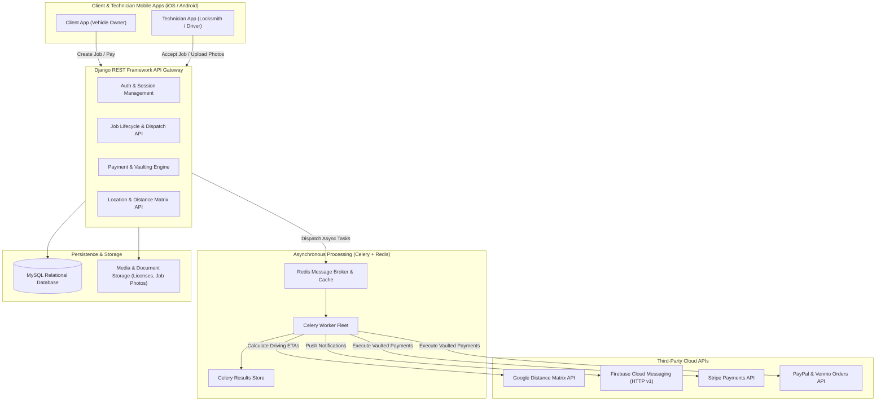

# OpenUp Portal — On-Demand Emergency Roadside & Vehicle Lockout Platform

> **Portfolio Project Showcase & Technical Deep Dive**  
> **Role:** Backend & API Engineer  
> **Stack:** Python, Django, Django REST Framework, MySQL, Celery, Redis, Firebase Cloud Messaging (FCM v1), Google Distance Matrix API, Stripe, PayPal REST API, Venmo, Apple Pay

---

## 1. Executive Summary & Portfolio Overview

**OpenUp** is an on-demand emergency roadside assistance and automotive lockout dispatch ecosystem (an "Uber for roadside locksmith & vehicle lockout services"). The platform bridges vehicle owners in distress with vetted, nearby mobile service technicians in real time.

The backend is built with **Django REST Framework (DRF)**, orchestrating an automated dispatch engine powered by **Google Distance Matrix API**, background asynchronous workers via **Celery & Redis**, multi-channel push notification pipelines via **Firebase Cloud Messaging (FCM HTTP v1)**, and a multi-provider payment vaulting architecture (**Stripe, PayPal Vault, Venmo, Apple Pay**).

### Portfolio Elevator Pitch
> *"Engineered the complete RESTful backend and dispatch engine for OpenUp, an on-demand roadside assistance platform. Built real-time geolocation matching using Google Distance Matrix API, an asynchronous event-driven task queue with Celery/Redis, and an omni-channel fintech pipeline supporting Stripe, Apple Pay, PayPal, and Venmo vaulting with zero-touch frictionless charging upon job completion."*

---

## 2. Core Functional Highlights

### 🚗 Client Experience (Vehicle Owner)
* **Instant Emergency Dispatch:** Request on-demand emergency lockout or scheduled vehicle roadside assistance with GPS location pin.
* **Smart Matching & ETAs:** Automatically calculates driving distance and technician arrival time using real-time traffic data.
* **Seamless Payment Vaulting:** Add and tokenize credit/debit cards, PayPal accounts, Venmo accounts, or Apple Pay once; automatic background charging on service completion.
* **Service Inspection Verification:** Inspect and verify before/after photos of vehicle locks and doors uploaded by technicians to ensure quality and damage liability control.
* **Ratings & Reviews:** Interactive star ratings and direct feedback loop upon job completion.

### 🛠️ Field Technician / Employee Experience
* **Availability Toggle:** Shift management (`employee_status`) to go online/offline for job requests.
* **Proximity Alert Radar:** High-priority push notifications for jobs within a dynamic travel radius (e.g., 21-minute driving threshold).
* **Job Execution Workflow:** Accept/reject jobs, live turn-by-turn routing to client coordinates, job state transitions (`Active` → `Accepted` → `In-Progress` → `Completed`).
* **Photo Proof System:** Mandatory camera uploads for pre-service condition and post-unlock verification.

### 🏢 Platform & Dispatch Engine
* **Automated Cascade Dispatch:** If the closest technician declines or cancels, the dispatch engine cascades the alert to the next eligible technician without alerting previously declined staff.
* **Radius-Based Availability Check:** Instant fallback notification when no technician is within the operational radius.
* **Session & Identity Management:** Secure token-based session management, device tracking (iOS/Android), and account activation workflows.

---

## 3. Technology Stack & Libraries Used

| Layer / Category | Technology / Library | Version | Purpose in Project |
| :--- | :--- | :--- | :--- |
| **Backend Framework** | **Python** / **Django** | 3.10+ / 4.1.7 | Core web framework, ORM, URL routing, middleware, administrative tools |
| **API Architecture** | **Django REST Framework (DRF)** | 3.14.0 | RESTful API endpoints, request serialization, data validation, response formatting |
| **Database** | **MySQL** (`mysqlclient`) | 8.0+ / 2.1.1+ | Primary relational database storing users, jobs, vehicles, payments, logs, and alerts |
| **Task Queue & Async** | **Celery** | 5.4.0 | Asynchronous job dispatching, alert retries, notifications, and scheduled background tasks |
| **Message Broker / Cache** | **Redis** (`redis-py`) | 4.5.1 | High-performance in-memory message broker for Celery and caching layer |
| **Task Result Backend** | **django-celery-results** | 2.5.0 | Persists Celery task execution states and results into the relational database |
| **Push Notifications** | **Firebase Cloud Messaging (FCM)** | HTTP v1 | High-priority push notifications to iOS and Android devices for instant job alerts |
| **Authentication & Auth** | **Google Auth (OAuth2)** | 2.56.2 | Token generation and service account authentication for Firebase HTTP v1 API |
| **Geolocation & Routing** | **Google Distance Matrix API** | v2 | Precise driving duration and distance calculations based on live traffic conditions |
| **Geo Utilities** | **Geopy** & **Geographiclib** | 2.3.0 / 2.0 | Coordinate manipulations, distance validations, and geospatial calculations |
| **Payments (Card/Vault)** | **Stripe** | 5.3.0 | Payment Intents, Customer Vaulting, Card pre-authorization and captures |
| **Payments (PayPal/Venmo)**| **PayPal REST SDK & Orders v2** | 1.13.1 / v2 | Customer Vaulting, PayPal card tokenization, and custom Venmo approval workflows |
| **Digital Wallets** | **Apple Pay** | Integrated | Mobile in-app payment authorization and pass-through token processing |
| **Image Processing** | **Pillow (PIL)** | 10.2.0 | Dynamic processing and validation of uploaded driver's licenses and before/after job images |
| **Configuration** | **django-environ** | 0.10.0 | Twelve-Factor App compliance; secure 128-bit secret and credential management via `.env` |
| **WSGI / Deployment** | **Gunicorn** | 20.1.0 | Production WSGI HTTP server |
| **Cryptographic Utilities** | **Cryptography** & **Passlib** | 50.0.0 / 1.7.4 | Password hashing, token encryption, and signature validation |

---

## 4. Database Architecture & Core Models

The database is built on **MySQL** with normalized relational tables:

```
                  ┌──────────────────────┐
                  │      UserRole        │
                  ├──────────────────────┤
                  │ role_id (PK)         │
                  │ role_name (client/emp)│
                  └──────────┬───────────┘
                             │ 1:N
                             ▼
                  ┌──────────────────────┐
          ┌───────┤     Registration     ├────────┐
          │       │      (users)         │        │
          │       ├──────────────────────┤        │
          │       │ user_id (PK)         │        │
          │       │ email, phone, role   │        │
          │       │ latitude, longitude  │        │
          │       │ fcm_token, stripe_id │        │
          │       └──────────┬───────────┘        │
          │                  │                    │
      1:N │              1:N │                1:N │
          ▼                  ▼                    ▼
┌──────────────────┐ ┌──────────────┐   ┌──────────────────┐
│  VehicleDetails  │ │   Session    │   │  PaypalInfo /    │
├──────────────────┤ ├──────────────┤   │  Payment (Stripe)│
│ vehicle_id (PK)  │ │ session_token│   ├──────────────────┤
│ make, model, year│ │ expires_at   │   │ vault_id         │
│ license_photo    │ └──────────────┘   │ customer_id      │
└──────────────────┘                    └──────────────────┘
          │
          │ 1:N
          ▼
┌────────────────────────────────────────────────────────┐
│                         Jobs                           │
│                      (userjob)                         │
├────────────────────────────────────────────────────────┤
│ job_id (PK)                                            │
│ user_id (Client FK)                                    │
│ job_accepted_by (Employee ID)                          │
│ job_type ("service" | "emergency")                     │
│ job_status (1:Active, 2:Accepted, 3:Completed, 4:Cancel)│
│ location_latitude, location_longitude                  │
│ job_pay_status, job_payment_id                         │
└──────────┬─────────────────────────────────┬───────────┘
           │ 1:N                             │ 1:1
           ▼                                 ▼
┌──────────────────────┐           ┌───────────────────┐
│     JobLogs /        │           │     Feedback      │
│      Alerts          │           ├───────────────────┤
├──────────────────────┤           │ stars (float)     │
│ log_msg, cancel_by   │           │ comment           │
│ notified_users       │           └───────────────────┘
└──────────────────────┘
```

### Key Entities
1. **`users` (`Registration`):** Supports dual roles (`client` and `employee`), real-time coordinates, device metadata (iOS/Android), FCM push token, and default payment references.
2. **`userjob` (`Jobs`):** Central state entity tracking the service request, emergency status, vehicle specifications, geo-coordinates, assigned technician, and payment completion status.
3. **`vehicle_model` (`VehicleDetails`):** Stores vehicle make, model, year, color, window tint, modifications, and uploaded vehicle registration/license images.
4. **`user_sessions` (`Session`):** Multi-device login session management with automated expiration and token verification.
5. **`alerts` & `job_log` (`JobLogs`):** Complete audit trail tracking which technicians received notifications, acceptance timestamps, rejections, and cancellation reasons.
6. **`paypal_cust_info` & `payment`:** Secure tokenized vault storage for cards, Stripe customer IDs, PayPal vault IDs, and Venmo authorization links.

---

## 5. Architectural Deep Dives & Key Engineering Feats

### 1. Real-Time Dynamic Geolocation Dispatching
* **Problem:** Roadside lockouts are time-critical emergencies. Blasting notifications to all technicians causes race conditions and poor response times.
* **Solution:** Developed an intelligent dispatch task (`jobAlert`). Upon job creation, the backend queries active technicians (`employee_status = 1`), calculates road-driving durations using the **Google Distance Matrix API**, and filters technicians within an optimal drive-time threshold (e.g., $\le$ 21 minutes / 1260 seconds).
* **Cascade Re-Alerting:** If an accepting technician cancels, the system automatically marks the cancellation in `JobLogs`, excludes the canceling technician, and cascades the job to the next nearest available technicians via asynchronous Celery tasks.

### 2. Multi-Provider FinTech Vaulting Architecture
* **Unified Vault Concept:** Unlike standard checkout flows that redirect users to payment screens on every order, OpenUp requires an Uber-like "vault-and-charge" experience.
* **Stripe Integration:** Integrated Stripe Customer and PaymentMethod APIs to securely store cards and execute off-session `PaymentIntents` when a job is marked completed by a technician.
* **Venmo Integration (via PayPal Orders v2 API):** Because Venmo does not use traditional card numbers, implemented an asynchronous 2-step OAuth linking contract:
  1. `POST /api/venmo-setup`: Backend generates an approval token and returns deep-link URLs to trigger the native Venmo app for one-time buyer authorization.
  2. `POST /api/venmo-confirm`: Exchanges the buyer authorization for a persistent PayPal Vault ID.
  3. Subsequent jobs charge the vaulted Venmo profile automatically in the background without user intervention.

### 3. High-Reliability Push Notification System (FCM HTTP v1)
* Migrated notification architecture to the modern **Google OAuth2 Service Account FCM v1 protocol**, avoiding legacy key deprecation issues.
* Engineered customized payload payloads carrying actionable metadata (`notificationScreenType: "addjob" | "review" | "no_availability"`), allowing the mobile client to automatically transition between waiting, navigation, and review screens.

---

## 6. Portfolio Resume Bullet Points (Ready to Copy)

* **Backend / Full-Stack Engineer Portfolio Bullets:**
  * *Architected and deployed a high-availability RESTful API and dispatch backend using Django REST Framework and MySQL for an on-demand vehicle lockout platform.*
  * *Designed an automated technician dispatch engine leveraging Google Distance Matrix API, cutting dispatch response times by matching clients with technicians within a 21-minute drive radius.*
  * *Engineered an asynchronous task pipeline using Celery and Redis to handle real-time job dispatching, cascade re-alerting, and automated push notifications via Firebase Cloud Messaging (FCM v1).*
  * *Implemented an omni-channel payment vaulting subsystem integrating Stripe, Apple Pay, PayPal, and Venmo, enabling frictionless post-service server-side payment capture.*
  * *Constructed robust audit and liability workflows, including mandatory pre/post-service photo documentation with dynamic storage pipelines using Pillow and Django FileField.*

---

## 7. System Architecture Diagram


