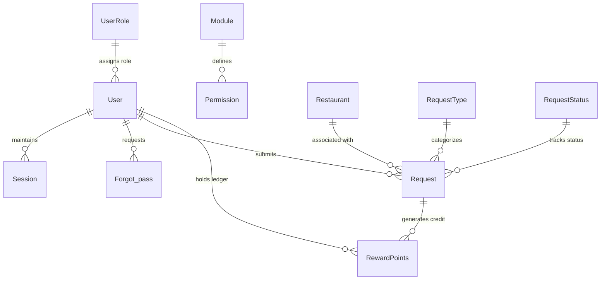

# Tequila's Mexican Restaurant — Multi-Location Dining Loyalty, Rewards Ledger & Operations Platform

> **Enterprise Customer Dining Rewards Engine, Dual-Mode Fraud-Resistant Claim Verification, Geo-Targeted Asynchronous FCM Push Notifications & Administrative Suite**  
> *Engineered with Python (Django & Django REST Framework), MySQL, Redis, Celery, Firebase Cloud Messaging (FCM v1/REST), Pillow, and Custom Dynamic RBAC.*

---

## 📌 Executive Summary

**Tequila's Mexican Restaurant Platform** is a specialized customer loyalty, dining reward accounting, and multi-branch operations platform engineered for a multi-location restaurant franchise (`tequilasmexicanrestaurants.com`). The platform bridges diner engagement on mobile interfaces with centralized operational control for restaurant administrators and floor managers.

The system addresses critical challenges in restaurant guest retention and loyalty program integrity:
1. **Preventing Loyalty Fraud**: Implementing a dual-mode claim verification pipeline that authenticates dining visits via real-time GPS coordinates or physical bill/receipt photo verification with automated daily rate-limiting per customer per branch.
2. **Double-Entry Style Points Accounting**: Providing an auditable rewards ledger that tracks point accruals and strictly regulates redemptions in discrete increments (multiples of 100 points) against validated running balances.
3. **Geo-Targeted Asynchronous Customer Engagement**: Empowering branch managers to publish branch-specific promotions that trigger asynchronous Celery workers to broadcast rich push notifications via Firebase Cloud Messaging (FCM) exclusively to diners who favorited those specific locations.
4. **Custom Full-Featured Operations Portal**: Replacing generic administration tools with a responsive web suite equipped with custom stateless session authentication, server-side paginated DataTables, and modular Role-Based Access Control (RBAC).

---

## 🚀 Key Highlights & Architectural Achievements

- **Dual-Mode Fraud-Resistant Reward Claim Engine**:
  - **Mode 1 — GPS Check-In Verification**: Captures diner location coordinates (`request_lat`, `request_long`) at the restaurant table to authenticate physical presence.
  - **Mode 2 — Bill / Invoice Receipt Validation**: Ingests photograph uploads of physical receipts with server-side image verification via **Pillow** (`Image.verify()`) to filter corrupted or invalid media files.
  - **Daily Claim Throttling**: Eliminates duplicate reward abuse by enforcing a database-backed daily check (`get_requests_for_user_today`), preventing users from submitting multiple claims of the same type at a branch on the same calendar day.
- **Auditable Reward Points Ledger & Redemption Matrix**:
  - Maintained in a dedicated `RewardPoints` transactional table tracking credit records (`point_mode = 1`, reward approval) and debit records (`point_mode = 2`, redemption) alongside running snapshot balances.
  - Dynamic balance computation (`calculate_balance`) continuously validates ledger integrity.
  - Enforces a strict redemption policy requiring redemption values to be exact multiples of 100 points (`validate_points`: `points % 100 == 0`) while ensuring the diner has sufficient verified balance.
- **Asynchronous Geo-Targeted Push Notifications (Celery + Redis + FCM)**:
  - Offloaded notification broadcasting to background **Celery** workers (`send_notification.delay(offer_details)`), decoupling promotional publish actions from HTTP response cycles.
  - Dynamically isolates target diners by querying users who marked the participating branch locations as their favorites (`user_fav__contains`).
  - Tailors multi-platform payload headers for Firebase Cloud Messaging (FCM): custom iOS sound (`notification.wav`), APNs expiration timestamps, Android message TTLs, and Webpush configurations.
- **Stateless Hex Token Session Management & Dual-Tier Auth**:
  - Designed a high-performance database-backed token session engine (`user_sessions`) utilizing cryptographically secure tokens (`secrets.token_hex()`) with dynamic expiration handling.
  - Segmented authorization layers separating mobile API consumers (`token_verification` decorator/middleware) from administrative dashboard staff (`@login_required` decorator).
  - Secure credential storage using PBKDF2-SHA256 salted password hashing alongside a tokenized email password-reset pipeline.
- **Granular Role-Based Access Control (RBAC)**:
  - Built a modular permission matrix (`Module`, `Permission`, `UserRole`) supporting granular permission flags (`Read`, `Write`, `Create`, `Remove`) across platform operational zones (Restaurants, Users, Offers, Reward Requests).
- **Server-Side Paginated Admin Management Suite**:
  - Custom responsive administrative frontend featuring AJAX-powered DataTables with dynamic server-side sorting, text search, offset-based pagination, and image previews without external admin dependencies.

---

## 🛠️ Technology Stack & Libraries

### 1. Core Languages & Frameworks
| Technology | Version / Specification | Role & Purpose |
|---|---|---|
| **Python** | `3.10+ / 3.11` | Primary backend language powering business logic, REST APIs, ledger calculations, and background workers. |
| **Django** | `4.2.7` | Core web application framework providing the ORM, migration engine, templating, session handling, and security middleware. |
| **Django REST Framework (DRF)** | `3.14.0` | Powers API serialization, request validation, status response formatting, and view decorators (`@api_view`). |
| **SQL (MySQL Dialect)** | `8.0+` | Relational schema definition, transactional data persistence, foreign key cascades, and indexing. |

---

### 2. Databases, Caching & Message Brokers
| Technology | Package / Driver | Purpose |
|---|---|---|
| **MySQL** | `8.0+` / `mysqlclient` | Primary ACID-compliant relational database storing users, sessions, restaurant branches, offers, claim requests, and reward ledgers. |
| **Redis** | `7.x` (`redis://127.0.0.1:6379/0`) | In-memory high-throughput data store functioning as the message broker and task queue for Celery. |
| **Django ORM** | Built-in | Abstracted query builder enforcing soft-delete query exclusions (`exclude(is_delete=1)`), relational joins, and atomic transactions. |

---

### 3. Asynchronous Task Execution & Background Processing
| Library / Package | Version | Description & Role |
|---|---|---|
| **Celery** | `5.x+` (Integrated) | Distributed asynchronous task queue executing push notification broadcasts without blocking API request threads. |
| **Kombu & Billiard** | Underlying Celery | Message transport abstraction and multiprocessing pool manager handling concurrent worker execution. |
| **Celery Autodiscovery** | `app.autodiscover_tasks()` | Automatically discovers and registers background tasks across installed Django application modules. |

---

### 4. Push Notifications, Cloud Messaging & Communications
| Library / Service | Specification | Role & Description |
|---|---|---|
| **Firebase Cloud Messaging (FCM)** | Google FCM API | Cross-platform push notification engine delivering targeted promotional alerts and reward status notifications to iOS, Android, and Web devices. |
| **Apple Push Notification Service (APNs)** | Payload via FCM | Custom APNs payload configuration specifying custom alert sounds (`notification.wav`), background wake flags (`content_available`), and message expiration. |
| **Django Core Mail & SMTP** | `django.core.mail` | Transactional email delivery engine rendering dynamic HTML and plaintext templates for password reset tokens and verification. |
| **Requests & Requests-Toolbelt** | `2.32.3`, `1.0.0` | HTTP client library utilized for outbound communication to third-party endpoints and FCM gateway APIs. |

---

### 5. Media Processing, Image Validation & Security
| Library / Package | Version | Description & Role |
|---|---|---|
| **Pillow (PIL)** | `10.1.0` | Server-side image manipulation and integrity verification (`Image.verify()`) preventing invalid or malicious file uploads in receipt claim requests. |
| **django-cors-headers** | `3.x / 4.x` | Cross-Origin Resource Sharing middleware enabling secure cross-origin requests from the administrative portal domain. |
| **django-environ** | `0.11.2` | Twelve-Factor App environment variable parser managing credentials, database strings, and secret keys from `.env`. |
| **Python Secrets & Hashers** | Built-in Standard Library | Cryptographically secure hex token generation (`secrets.token_hex()`) and salted PBKDF2 password hashing. |
| **TimedRotatingFileHandler** | Python Logging | Automated log file rotation writing structured application and error logs to `logs/debug_logs.log`. |

---

### 6. Admin Frontend & UI Components
| Technology / Library | Specification | Purpose |
|---|---|---|
| **HTML5 & CSS3** | Custom BEM Architecture | Responsive layout structure with dedicated desktop and mobile sidebar navigations. |
| **JavaScript (ES6+) & jQuery** | `jQuery-min.js` | Client-side DOM manipulation, asynchronous AJAX data retrieval, and modal control. |
| **Select2** | `4.1.0-rc.0` (CDN) | Enhanced multi-select input controls enabling seamless restaurant branch tagging when creating promotional offers. |
| **TopBar.js** | `topbar.min.js` | Visual progress bar animating network latency during asynchronous page transitions and AJAX requests. |

---

## 🏛️ System Architecture & Data Flow

```
+─────────────────────────────────────────────────────────────────────────────+
|                                CLIENT SURFACES                              |
|   [Diner Mobile App (iOS / Android)]        [Restaurant Admin & Staff Web]  |
+─────────────────────────────────────────────────────────────────────────────+
                 │                                           │
                 │ HTTPS (JSON / Multipart)                  │ HTTPS (HTML / AJAX)
                 ▼                                           ▼
+─────────────────────────────────────────────────────────────────────────────+
|                     DJANGO APPLICATION ENGINE (TAQUILA)                     |
|                                                                             |
|  [Security & Middleware]   ──►  [Business View Layer]  ──►  [DRF Serializers]|
|  - TokenVerification            - Reward Request System     - UserSerializer |
|  - Session Authentication       - Points Ledger & Redeem    - RestroSerializer|
|  - CORS & Error Handlers        - Offers & Branches         - RequestSerializer|
|  - Input Regex Validators       - RBAC Access Control       - RewardPointsSer|
+──────────────────────────┬─────────────────────────────────┬────────────────+
                           │                                 │
         Asynchronous Task │                                 │ Transactional
         Dispatching       ▼                                 ▼ Operations
+─────────────────────────────────────────+     +─────────────────────────────+
|        CELERY DISTRIBUTED WORKERS       |     |      MYSQL DATABASE         |
|  - Geo-Targeted Offer Broadcasts        |     |  - users & user_sessions    |
|  - Diner Favorite Matching              |     |  - restaurants & offers     |
|  - Multi-Platform FCM Payload Builder   |◄───►|  - request & request_status |
+────────────────────┬────────────────────+     |  - reward_points (Ledger)   |
                     │                          |  - userrole & permissions   |
        Task Queue   ▼                          +─────────────────────────────+
+─────────────────────────────────────────+                    │
|          REDIS MESSAGE BROKER           |                    │
|  - Celery Worker Broker (Port 6379)     |                    │ Outbound Email
|  - In-Memory Task Serialization         |                    ▼
+─────────────────────────────────────────+     +─────────────────────────────+
                     │                          |     SMTP EMAIL GATEWAY      |
        Push Dispatch│                          |  - Password Reset Links     |
                     ▼                          |  - Account Verification     |
+─────────────────────────────────────────+     +─────────────────────────────+
|    FIREBASE CLOUD MESSAGING (FCM)       |
|  - APNs Tailored Payloads (iOS Sound)   |
|  - Android TTL & Webpush Formatting     |
+────────────────────┬────────────────────+
                     │
                     ▼
+─────────────────────────────────────────+
|         TARGET DINER DEVICES            |
|  (Filtered by Favorited Restaurant)     |
+─────────────────────────────────────────+
```

---

## 🗄️ Database Schema & Relational Modeling

The database architecture is designed with strict transactional integrity, foreign key relations, and soft-delete capabilities across all entities.



### Key Relational Entities:

1. **`users` (`User`)**:
   - Stores diner and staff credentials, encrypted password hash (`user_password`), profile picture, phone number, FCM device token (`user_fcm_token`), device type (`0` for iOS, `1` for Android), comma-separated list of favorited restaurant IDs (`user_fav`), and role reference (`user_role`).
2. **`user_sessions` (`Session`)**:
   - Manages token-based session lifetimes (`session_token`, `session_exp`, `session_status`) providing stateless authorization for mobile consumers and web administrators.
3. **`restaurants` (`Restaurant`)**:
   - Multi-location branch profiles storing location address, promotional description, official ordering URL, branding hero image (`res_image`), and FCM topic key.
4. **`offers` (`Offers`)**:
   - Promotional campaigns containing title, detailed terms, and a comma-delimited mapping of participating restaurant branches (`offer_res`).
5. **`request` (`Request`)**:
   - Ingests customer reward claims. Captures claim type (`request_type`: Location Check-In vs. Invoice Receipt), branch reference (`request_res`), diner reference (`request_user`), receipt image attachment (`request_image`), GPS coordinates (`request_lat`, `request_long`), status (`request_status`), and admin-assigned eligible points.
6. **`reward_points` (`RewardPoints`)**:
   - Core accounting ledger tracking all point mutations. Records source request ID, diner ID, transaction direction (`point_mode`: `1` for credit/inflow, `2` for debit/redemption), transaction magnitude (`point_value`), and historical snapshot balance (`point_balance`).
7. **`userrole`, `module`, `permission`**:
   - Granular RBAC configuration mapping system modules to CRUD permission sets (`Read`, `Write`, `Create`, `Remove`).

---

## ⚙️ Core Functional Modules & Domain Capabilities

### 1. Dual-Mode Reward Claim & Anti-Fraud Verification
- **Location Check-In Verification**:
  - Diners physically dining at a restaurant branch submit real-time GPS coordinates (`location_lat`, `location_long`). The system validates the location parameters before queuing the claim.
- **Physical Receipt / Bill Image Validation**:
  - Diners dining or ordering takeout upload an image of their receipt. The view processes the binary stream through **Pillow** (`Image.open(request_image).verify()`), catching corrupted or forged payloads before writing to disk.
- **Automated Anti-Abuse Throttling**:
  - Queries claims created on the current date for the requesting diner (`get_requests_for_user_today`). If a claim of the same type was already submitted for that day, subsequent attempts are rejected immediately, protecting the restaurant against claim spamming.
- **Review & Approval Workflow**:
  - Submitted requests enter the `In Review` state. Restaurant administrators inspect the receipt photograph or GPS coordinates in the admin console and designate the eligible reward points upon approval.

### 2. Double-Entry Style Points Ledger & Redemption Engine
- **Transactional Accounting**:
  - Points are never updated via destructive overwrites. Every reward approval writes an additive credit transaction (`point_mode = 1`) referencing the source claim. Every redemption writes a deductive debit transaction (`point_mode = 2`).
- **Dynamic Balance Resolution**:
  - `calculate_balance(user)` aggregates total historical credits and debits to ascertain the authoritative available balance before approving redemptions or displaying diner balances.
- **Strict Multiples-of-100 Redemption Rule**:
  - The redemption endpoint enforces business rules requiring point redemptions to occur strictly in increments of 100 points (`points % 100 == 0`). Non-compliant requests or requests exceeding the verified available balance are rejected with explicit feedback.

### 3. Asynchronous Geo-Targeted Push Notifications (Celery + Redis + FCM)
- **Decoupled Task Execution**:
  - Creating a promotional offer initiates a Celery background task: `send_notification.delay(offer_details)`. The web server returns an immediate HTTP response, ensuring zero UI freeze.
- **Diner Affinity Matching**:
  - Parses the selected restaurant branch IDs and constructs a dynamic Django Q-object query:
    ```python
    q_objects = Q()
    for res_id in rest_list:
        q_objects |= Q(user_fav__contains=res_id)
    users = User.objects.exclude(user_is_delete=1).filter(q_objects)
    ```
  - Isolates diners who have actively favorited the relevant branches, preventing alert fatigue for unrelated branches.
- **Platform-Tailored Payloads**:
  - Configures Apple Push Notification Service (APNs) headers with custom sound cues (`notification.wav`), background execution flags (`content_available: true`), and expiration calculations, alongside Android TTL parameters.

### 4. Restaurant Branch Directory & Multi-Location Favoriting
- **Branch Directory**:
  - Exposes paginated restaurant branch profiles complete with location addresses, hero photography, operational descriptions, and direct external reservation/menu ordering links.
- **Personalized Branch Favoriting**:
  - Diners can toggle branches as favorites (`favourite_reaturant` endpoint). The system maintains this affinity set, dynamically adjusting response flags (`is_fav: 1 / 0`) in branch directory listings and powering the push notification targeting engine.

### 5. Custom Session Authorization & Security Pipeline
- **Stateless Hex Token Authentication**:
  - Uses `secrets.token_hex()` to generate high-entropy authentication tokens stored with explicit datetime expiration (`session_exp = timezone.now() + timedelta(days=1)`).
- **Comprehensive Input Sanitization**:
  - Custom regex sanitizers sanitize names, phone numbers (international digit count validation between 8 and 15 digits), email syntax, and strip HTML/XSS injection tags (`<[^>]+>`).
- **Tokenized Password Reset Flow**:
  - Generates single-use recovery tokens stored in `forgot_password` with automatic expiration, dispatching styled HTML emails via Django SMTP.

### 6. Administrative Control Portal & Modular RBAC
- **Unified Back-Office Management**:
  - Features dedicated management consoles for **Restaurants**, **Users**, **Offers**, and **Reward Requests**.
- **Role-Based Access Control**:
  - Assigns operators granular permissions across modules, preventing unauthorized modifications to reward approvals or user credentials.
- **Interactive Server-Side Tables**:
  - Custom AJAX-driven tables handling sorting, fuzzy searching across names and addresses, and pagination controls.

---

## 📡 Comprehensive API Endpoint Reference

### 1. Customer Authentication & Profile Management
| Method | Endpoint | Description | Auth Required |
|---|---|---|---|
| `POST` | `/register` | Register new customer account with phone, password, and FCM device token | Public |
| `POST` | `/login` | Authenticate customer and issue session token | Public |
| `POST` | `/logout` | Invalidate active customer session token | Bearer Token |
| `POST` | `/change-pass` | Change authenticated customer password | Bearer Token |
| `POST` | `/user-profile` | Fetch customer account details, profile picture, and points | Bearer Token |
| `POST` | `/update-profile` | Update customer name, mobile number, or avatar photo | Bearer Token |
| `POST` | `/update-fcm` | Refresh diner FCM push notification token and device type | Bearer Token |

---

### 2. Restaurant Directory & Favorites
| Method | Endpoint | Description | Auth Required |
|---|---|---|---|
| `POST` | `/restro-list` | Fetch paginated restaurant branches with personalized `is_fav` flag | Bearer Token |
| `POST` | `/add-restro` | Add new restaurant branch (address, URL, description, photo) | Bearer Token |
| `POST` | `/favourite-reaturant` | Toggle restaurant branch in customer's favorite list | Bearer Token |

---

### 3. Offers & Promotions
| Method | Endpoint | Description | Auth Required |
|---|---|---|---|
| `POST` | `/offer-list` | List active promotional offers across restaurants | Bearer Token |
| `POST` | `/offer-details` | Retrieve granular offer terms and participating branch names | Bearer Token |

---

### 4. Reward Claims & Points Ledger
| Method | Endpoint | Description | Auth Required |
|---|---|---|---|
| `POST` | `/send-request` | Submit reward claim (Type 1: Location Check-In, Type 2: Receipt Image) | Bearer Token |
| `POST` | `/current-points` | Fetch real-time available reward points balance | Bearer Token |
| `POST` | `/reward-list` | Retrieve paginated reward claim history and approval statuses | Bearer Token |
| `POST` | `/redeem-point` | Redeem points in multiples of 100 against available ledger balance | Bearer Token |
| `POST` | `/redeem-history` | View historical point redemption voucher transactions | Bearer Token |

---

### 5. Content Management & Compliance
| Method | Endpoint | Description | Auth Required |
|---|---|---|---|
| `POST` | `/cms-pages` | Return direct links to Terms, Privacy, Copyright, and License pages | Public |
| `GET` | `/copyright-page` | Render HTML Copyright Information Page | Public |
| `GET` | `/terms-condition` | Render HTML Terms & Conditions Page | Public |
| `GET` | `/privacy-policy` | Render HTML Privacy Policy Page | Public |
| `GET` | `/software-license` | Render HTML Software License Page | Public |

---

### 6. Administrative Dashboard & Back-Office
| Method | Route | Module / Purpose |
|---|---|---|
| `GET / POST` | `/admin-login`, `/do-admin-login` | Admin portal credential authentication and session establishment |
| `GET` | `/admin-logout` | Terminate administrator session |
| `GET / POST` | `/res-master`, `/res-list` | Restaurant master overview and AJAX paginated data list |
| `GET / POST` | `/add-res`, `/res-save`, `/edit-res/<id>`, `/res-update`, `/remove-res/<id>` | Full CRUD operations for restaurant branch locations |
| `GET / POST` | `/user-master`, `/user-list`, `/add-user`, `/user-save`, `/edit-user/<id>`, `/remove-user/<id>` | Staff & user administration, credential management, role assignment |
| `POST` | `/save-role`, `/update-role`, `/edit-role/<id>`, `/remove-role/<id>` | Granular Role-Based Access Control (RBAC) configuration |
| `GET / POST` | `/offers-master`, `/offers-list`, `/offers-save`, `/view-offer/<id>`, `/remove-offer/<id>` | Create promotions and trigger asynchronous Celery FCM broadcasts |
| `GET / POST` | `/request-master`, `/request-list`, `/view-request/<id>` | Adjudicate customer receipt photos, inspect GPS, and review claims |
| `POST` | `/change-status` | Approve/Reject claims, allocate reward points, and write ledger credit |
| `GET / POST` | `/forget-password`, `/send-token`, `/reset-password/<token>`, `/change-password` | Admin tokenized password recovery and reset pipeline |

---

## ⚡ Real-World Engineering & Problem Solving

### 1. Eliminating Loyalty Program Fraud & Multi-Submissions
- **Challenge**: Diners could exploit loyalty rewards by repeatedly submitting fabricated invoices or falsifying location check-ins multiple times a day.
- **Solution**: Engineered a three-tiered defense:
  1. Strict rate limiting at the query layer via `get_requests_for_user_today()`, rejecting repeat claims for the same request type on the same date.
  2. Byte-level media verification via Pillow (`Image.verify()`) to ensure receipt attachments are legitimate, non-corrupt images.
  3. Human-in-the-loop review interface in the admin portal displaying the receipt image, date, and geolocation coordinates before allocating points.

### 2. High-Throughput Notification Dispatching without Request Blocking
- **Challenge**: Publishing an offer across multiple popular branches requires notifying thousands of subscribed diners. Executing sequential FCM HTTP requests in the web request thread causes worker timeouts (HTTP 504 Gateway Timeout) and degrading user experience.
- **Solution**: Offloaded message dispatch to a **Celery** background worker pool backed by a **Redis** message broker. The admin receives instant confirmation, while the background worker resolves diner favorites and executes the push broadcasts asynchronously.

### 3. Ledger Consistency & Integer Increment Redemption
- **Challenge**: Point balances could become inconsistent if calculated via mutable user counter fields subject to race conditions.
- **Solution**: Replaced mutable counters with an immutable transactional ledger (`reward_points`). All balances are derived dynamically from credits and debits (`calculate_balance`). Redemptions are mathematically validated to be positive integers divisible by 100 (`points % 100 == 0`), preventing fractional balance bugs and ensuring compliance with the restaurant chain's voucher policies.

---

## 📊 Portfolio Summary & Technical Highlights

| Criterion | Technical Specification |
|---|---|
| **Architecture Pattern** | Dual-Surface Platform (RESTful Mobile API Backend + Web Administrative Suite) |
| **Primary Framework** | Python 3.10+ / Django 4.2.7 / Django REST Framework 3.14.0 |
| **Database & ORM** | MySQL 8.0+ (ACID compliant) with Django ORM relational mapping |
| **Asynchronous Engine** | Celery Task Queue + Redis Broker (`redis://127.0.0.1:6379/0`) |
| **Push Notification Service** | Firebase Cloud Messaging (FCM) with customized APNs & Android payloads |
| **Media Processing** | Pillow (PIL 10.1.0) with automated image integrity validation |
| **Authentication & RBAC** | Cryptographic Token Sessions (`secrets.token_hex`) + Custom Module RBAC |
| **Admin UI Stack** | HTML5, CSS3, JavaScript (ES6+), jQuery, Select2, Topbar.js |
| **Domain Specialization** | Hospitality Tech, Customer Loyalty Programs, Multi-Branch Restaurant Operations |
